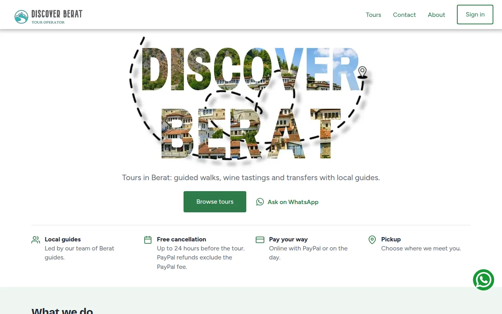
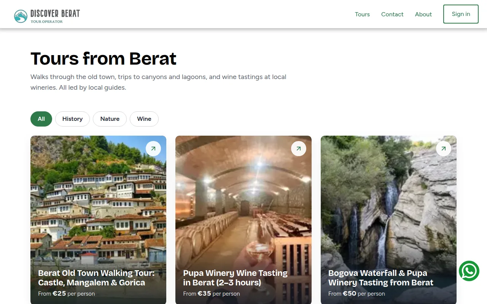
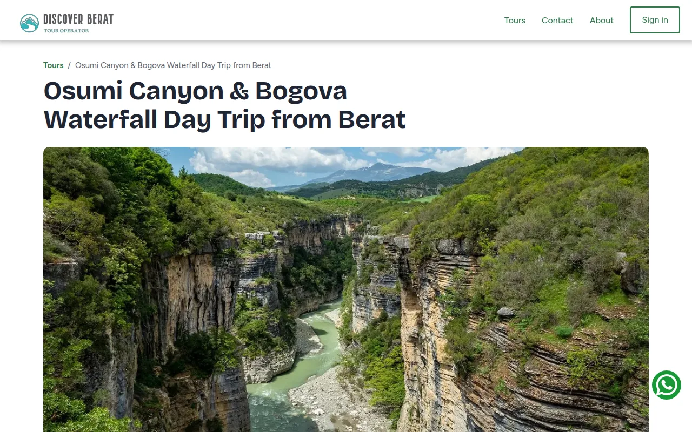
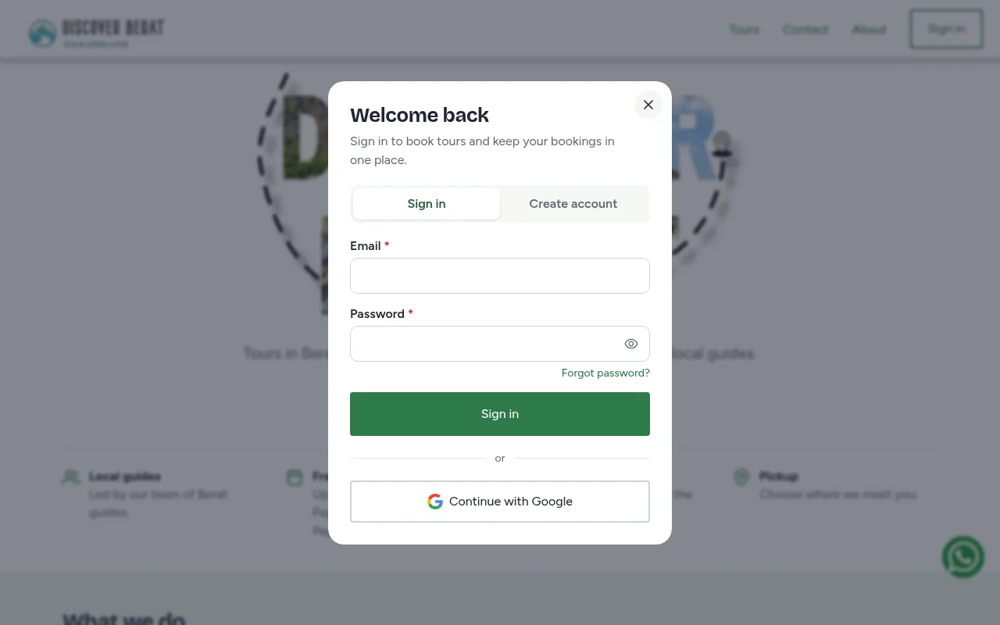
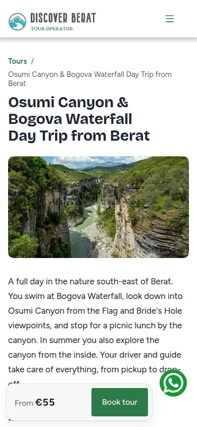

# Discover Berat

Booking website for a local tour operator in Berat, Albania. Guests browse tours, book a date and time slot, pay online with PayPal or on the day, and manage their bookings. The operator manages bookings and blocked dates from an admin dashboard.

**Live:** [discoverberat.com](https://discoverberat.com)



| Tours | Tour page | Sign-in modal | Mobile |
| --- | --- | --- | --- |
|  |  |  |  |

## Features

- **Tours from a headless CMS:** tours, prices and copy are managed in Contentful and rendered with ISR.
- **Bookings with capacity:** each tour slot holds up to 20 guests. Bookings run in a Firestore transaction, so concurrent bookings can't overbook a slot. The admin can block whole dates.
- **Payments:** PayPal checkout, capture, refunds on cancellation and a signature-verified webhook. The paid amount must match the booking total exactly.
- **Accounts:** Firebase Auth (email/password and Google) in a modal that works on any page. Email sign-ups must verify their address before they book.
- **User dashboard:** upcoming bookings, pay later, cancel up to 24 hours before, add to Google or Apple calendar, and saved tours.
- **Admin dashboard:** all bookings, booking history by tour and month, and a calendar to block dates.
- **Emails:** HTML confirmations, receipts and cancellation emails sent with Nodemailer.
- **Account deletion:** removes personal data and keeps anonymous booking records for the sales history.
- **SEO:** metadata and canonical URLs on every page, TravelAgency, TouristTrip and BreadcrumbList JSON-LD, sitemap, robots and `llms.txt`.

## Tech stack

| Area | Tools |
| --- | --- |
| Framework | Next.js 16 (App Router, Server Actions, React Compiler), React 19, TypeScript |
| Data | Firebase Firestore (Admin SDK on the server), Contentful |
| Auth | Firebase Auth, httpOnly session cookie verified on the server |
| Payments | PayPal Orders API and webhooks |
| Forms | react-hook-form |
| Testing | Jest, React Testing Library |
| Hosting | Vercel |

## Security notes

- Every server action verifies the Firebase ID token. The server never trusts a user ID, price, email or date sent by the browser.
- Prices and tour details come from Contentful on the server. The booking email comes from the verified token.
- Users can only read, pay or cancel their own bookings. Admin actions check the admin ID on the server.
- Firestore security rules deny all browser access except a user's own saved tours.
- The sign-in redirect only accepts paths on the same site.

## Project structure

```
src/
  app/                  Routes. Route-only components live in _components folders.
  components/
    ui/                 Button, Input, Card, Loader, Toast
    layout/             Layout, Navigation, Footer, CookieBanner
    auth/               Sign-in modal and forms
    tours/              Tour card grid
    payment/            PayPal checkout button
  hooks/                Client hooks
  lib/                  Auth, Firebase, payments, Contentful, email and booking helpers
  styles/               Global styles
```

## Getting started

Requires Node.js 20+ and pnpm.

```bash
pnpm install
pnpm dev
```

Open [http://localhost:3000](http://localhost:3000).

### Environment variables

Create `.env.local` with these values. Never commit them.

| Variable | Used for |
| --- | --- |
| `NEXT_PUBLIC_FIREBASE_API_KEY`, `NEXT_PUBLIC_FIREBASE_AUTH_DOMAIN`, `NEXT_PUBLIC_FIREBASE_PROJECT_ID`, `NEXT_PUBLIC_FIRESTORE_STORAGE_BUCKET`, `NEXT_PUBLIC_FIREBASE_MESSAGING_SENDER_ID`, `NEXT_PUBLIC_FIREBASE_APP_ID` | Firebase web app |
| `FIREBASE_PRIVATE_KEY`, `FIREBASE_PRIVATE_KEY_ID`, `FIREBASE_CLIENT_EMAIL`, `FIREBASE_CLIENT_ID`, `FIREBASE_CLIENT_X509_CERT_URL` | Firebase Admin service account |
| `ADMIN_ID` | Firebase user ID of the admin |
| `NEXT_PUBLIC_ADMIN` | Admin email that gets booking notifications |
| `CONTENTFUL_SPACE_ID`, `CONTENTFUL_ACCESS_TOKEN` | Contentful Delivery API |
| `NEXT_PUBLIC_PAYPAL_CLIENT_ID`, `PAYPAL_CLIENT_SECRET`, `PAYPAL_WEBHOOK_ID` | PayPal |
| `SMTP_CONNECTION_URI`, `DEFAULT_FROM` | Outgoing email |

## Scripts

| Command | Does |
| --- | --- |
| `pnpm dev` | Start the development server |
| `pnpm build` | Production build |
| `pnpm start` | Serve the production build |
| `pnpm lint` | ESLint |
| `pnpm test` | Jest tests |

## Release flow

Work happens on `preview`, which Vercel deploys as a preview site. Releases go from `preview` to `main` through a pull request with a merge commit. A GitHub workflow blocks pull requests into `main` from any other branch.

## License

[MIT](LICENSE)
